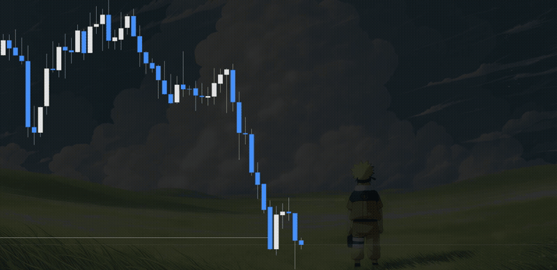

# TradingView Animated Wallpaper — Desktop & Chrome

**Animated wallpapers behind your TradingView charts. Free. No subscription.** Choose your own video or picture, or use the included animated background.

## Start here

### I use the TradingView Desktop app on a Mac

**[Download for Mac](https://github.com/vladimirdd96/tradingview-animated-wallpaper/releases/latest/download/TradingView-Desktop-Wallpaper.zip)** — everything included. No Terminal, coding, or extra software to install.

1. Open TradingView and leave your chart open.
2. Download the ZIP above and double-click it to unzip. Move **TradingView Wallpaper.app** into **Applications**.
3. Open **TradingView Wallpaper**. In the settings window, click **Choose file…** and pick a video or picture.

**Change it later:** TradingView’s top-right **⋯ → Wallpaper settings…**. After quitting and reopening TradingView, open **TradingView Wallpaper** again. You can keep it in your Dock.

**First-open help:** this app is not notarized by Apple. If macOS blocks it and you trust this download, go to **System Settings → Privacy & Security → Open Anyway**, then open it again. [Apple’s explanation](https://support.apple.com/102445). No commands to disable security are needed.

Tested on Mac / Apple Silicon with TradingView Desktop 3.4.0. An Intel runtime is included, but Intel Macs are not yet tested. Windows and Linux users can use the Chrome version below. [Mac help](desktop/README.md).

### I use TradingView in Google Chrome

**[Download for Chrome](https://github.com/vladimirdd96/tradingview-animated-wallpaper/releases/latest/download/TradingView-Chrome-Wallpaper.zip)**

1. Unzip the download and keep the **ChartWallpaper** folder somewhere permanent.
2. In Chrome, type **chrome://extensions** into the address bar. Turn on **Developer mode** at the top right.
3. Click **Load unpacked**, then select the **ChartWallpaper** folder.
4. Open or refresh your TradingView chart. Click Chrome’s **puzzle-piece icon → Chart Wallpaper → Choose custom wallpaper**.
5. Choose your file, click **Save wallpaper**, then refresh the chart.

Chrome requires these manual installation steps for this GitHub download. There is no Chrome Web Store listing yet. [Chrome help](chrome-extension/README.md).

## Video demo: actual TradingView Desktop

[](https://github.com/vladimirdd96/tradingview-animated-wallpaper/releases/download/v1.1.1/tradingview-desktop-animated-wallpaper-demo.mp4)

[Watch or download the 10-second MP4 demo](https://github.com/vladimirdd96/tradingview-animated-wallpaper/releases/download/v1.1.1/tradingview-desktop-animated-wallpaper-demo.mp4). Recorded from the actual running macOS Desktop app with a user-selected animated wallpaper, cropped to the chart. The original wallpaper file is not included. [Demo details and artwork notice](docs/media/README.md).

## What you can control

- Choose your own video, animated GIF, or picture. MP4, WebM, GIF, WebP, PNG, and JPEG files up to 40 MB work.
- Darken the wallpaper so candles and labels stay readable.
- Fill the chart or show the whole picture.
- Pause video, turn wallpaper off, or switch to the included aurora animation. GIFs cannot be paused.

Your files stay on your computer. Audio is muted. This tool does not place trades or require your TradingView password. No wallpaper library is included; use your own files. Short video loops work best.

## FAQ

### Can I use an animated Naruto wallpaper on TradingView?

Yes, select your own local MP4, WebM, or animated image. No Naruto video or other copyrighted wallpaper library is bundled. Desktop testing included a user-provided 4K MP4; the source tree includes a cropped demonstration preview and a small project-generated WebM test fixture.

### Is this a free ChartSkins alternative?

It provides independently implemented custom animated chart backgrounds without a subscription. It is not affiliated with ChartSkins or TradingView, and does not unlock either service's paid features or assets.

### Does the Chrome extension work inside TradingView Desktop?

No. Use the separate Desktop companion for the actual macOS Desktop app. Both are included in this repository.

### Will I need to log in again?

The Desktop launcher attaches to the app you already have open. It does not create another profile or restart that app. Normal TradingView authentication still applies.

### Can this place trades or change my strategy?

No. The packages modify chart presentation. They do not place orders, execute strategies, or provide investment advice.

### Will the wallpaper appear in exported chart screenshots?

TradingView's built-in chart export may omit the media layer. A full app/window screenshot captures the visible wallpaper.

<details>
<summary>For developers and AI agents</summary>

The Chrome download is a Manifest V3 extension. The Mac app includes official Node.js runtimes; the separate Desktop Source ZIP is for developers who already have Node.js 22+. The Mac app does not install Node.js system-wide, need a package manager, or download code when opened.

The Desktop companion attaches to the already-running TradingView app. It never launches, quits, or restarts TradingView and does not patch its signed app bundle. Rendering hooks may need updates after TradingView changes.

```sh
node scripts/check.mjs
python3 scripts/build_release.py
# On macOS: also build the self-contained app (downloads verified official runtimes)
python3 scripts/build_release.py --mac-app
```

[Agent guide](AGENTS.md) · [Agent index](llms.txt) · [Architecture](docs/architecture.md) · [Security](docs/security.md) · [Tests](docs/testing.md) · [Compatibility](docs/compatibility.md) · [Contributing](CONTRIBUTING.md)

Release archives use explicit file lists to exclude settings, session tokens, and private media. Only the creator-approved cropped demo is published.

</details>

## License and affiliation

[MIT License](LICENSE) for project code; bundled Node.js has its own included license. Demo artwork belongs to its rights holders. This independent project is not affiliated with TradingView or ChartSkins. TradingView’s own plans and terms still apply.
